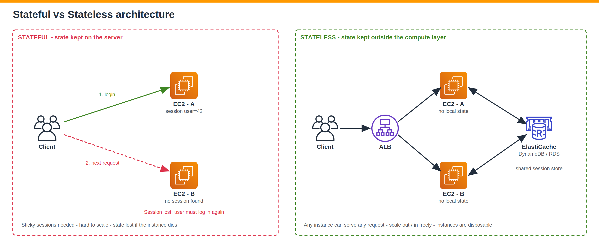
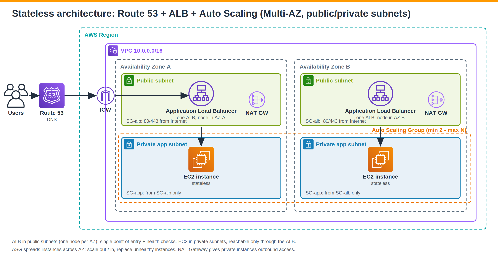
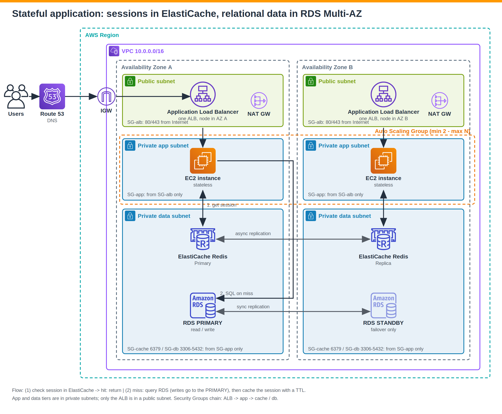
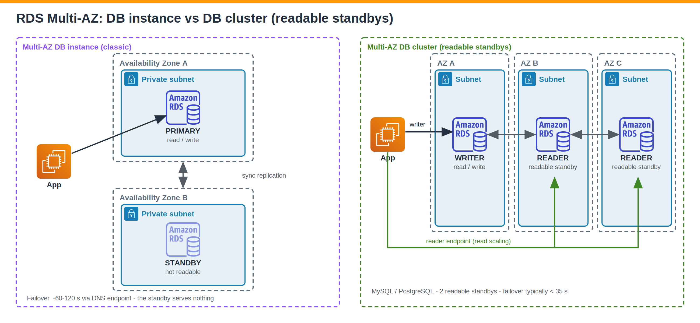
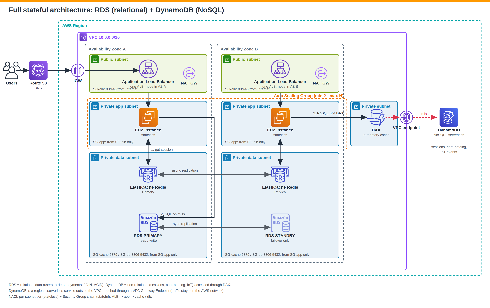
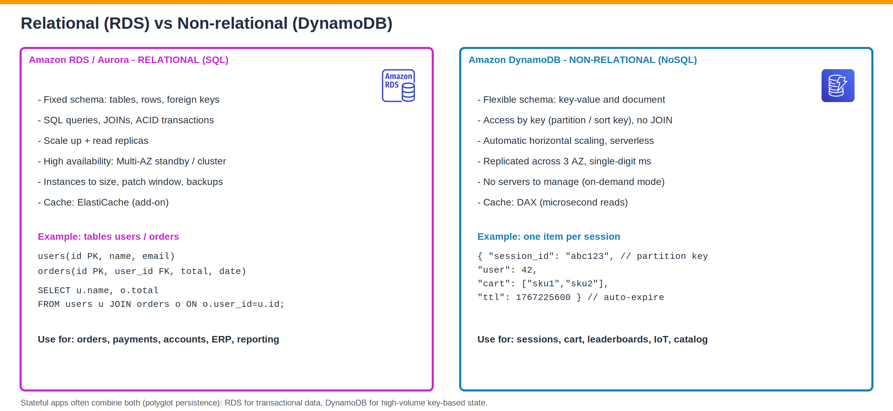
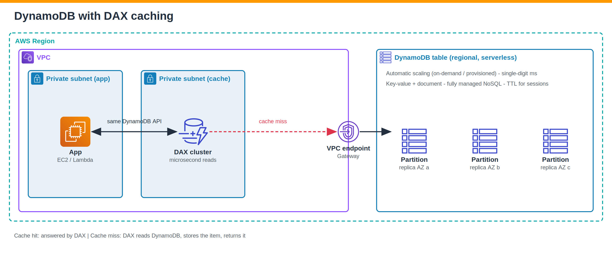
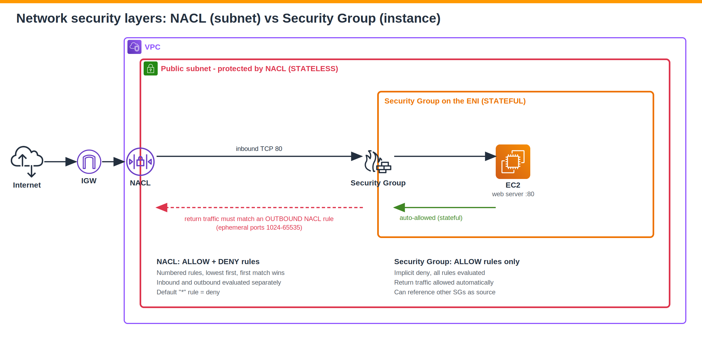
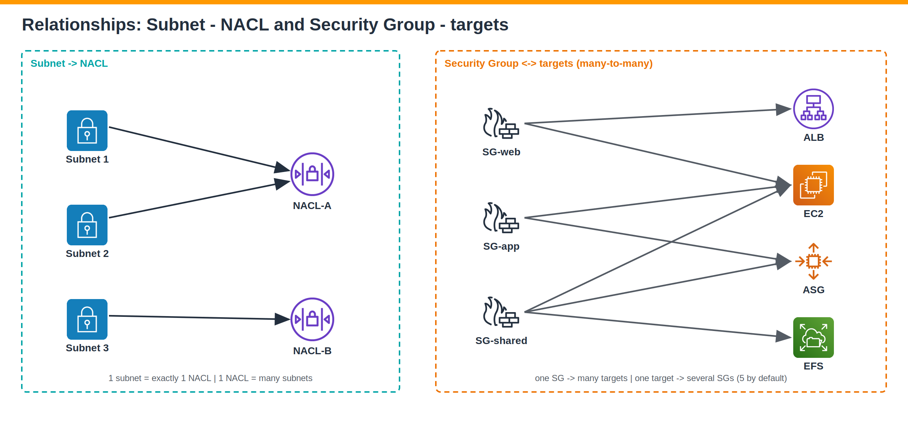

# AWS System Design : Architectures Stateless, Stateful, Bases de données & Sécurité réseau

> Notes d'étude structurées sur la conception d'architectures modulaires, scalables et hautement disponibles sur AWS.
> Chaque section contient un schéma en **PNG haute résolution** (version **SVG** vectorielle éditable disponible, avec icônes AWS) dans [`docs/images`](docs/images).


---

## Lire les schémas (conventions AWS)

Les schémas utilisent les **icônes AWS** et la hiérarchie standard d'une architecture AWS :

| Élément | Représentation |
|---|---|
| **Region** | Cadre pointillé turquoise |
| **VPC** | Cadre violet |
| **Availability Zone (AZ)** | Cadre pointillé gris |
| **Public subnet** | Cadre **vert** (icône cadenas ouvert) : ALB, NAT Gateway |
| **Private subnet** | Cadre **bleu** (icône cadenas fermé) : EC2, ElastiCache, RDS, DAX |
| **Auto Scaling Group** | Cadre pointillé orange autour des instances EC2 |

> Les instances applicatives et les bases de données sont toujours en **subnet privé**. Seul l'ALB (et la NAT Gateway) est en **subnet public**.

---

## Table des matières

1. [Principe : System design modulaire](#1-principe--system-design-modulaire)
2. [Stateful vs Stateless](#2-stateful-vs-stateless)
3. [Architecture Stateless](#3-architecture-stateless)
4. [Évaluer une architecture (Well-Architected)](#4-évaluer-une-architecture-well-architected-framework)
5. [Application Stateful : sessions, cache, RDS et DynamoDB (architecture complète)](#5-application-stateful--sessions-cache-et-base-de-données)
6. [Amazon DynamoDB](#6-amazon-dynamodb)
7. [Security Group vs NACL](#7-security-group-vs-nacl)
8. [Relations entre les composants](#8-relations-entre-les-composants)
9. [Checklist & bonnes pratiques](#9-checklist--bonnes-pratiques)
10. [Glossaire](#10-glossaire)

---

## 1. Principe : System design modulaire

Une architecture **modulaire** découpe le système en briques indépendantes, chacune avec une responsabilité claire :

| Couche | Rôle | Services AWS typiques |
|---|---|---|
| DNS / Edge | Résolution de noms, routage global | Route 53, CloudFront |
| Entrée | Point d'entrée unique, répartition de charge | ALB / NLB |
| Calcul | Exécution applicative, élasticité | EC2 + Auto Scaling Group, ECS, Lambda |
| Cache | Latence faible, déchargement de la base | ElastiCache, DAX |
| Données | Persistance | RDS, Aurora, DynamoDB, S3, EFS |
| Sécurité | Contrôle des flux | Security Groups, NACL, IAM, WAF |

Chaque brique peut être **remplacée, scalée ou testée séparément**, ce qui facilite l'évolution et la résilience.

---

## 2. Stateful vs Stateless



| | **Stateful** | **Stateless** |
|---|---|---|
| Définition | Le serveur **mémorise** l'état de la conversation (un point de départ et un point d'arrivée liés : login → actions → logout) | Chaque requête est **autonome** : le serveur ne garde rien entre deux requêtes |
| Où est l'état ? | Sur l'instance (mémoire / disque local) | À l'extérieur : cache, base de données, token (JWT), S3 |
| Scalabilité | Difficile (sticky sessions) | Simple : on ajoute / retire des instances |
| Panne d'une instance | Perte des sessions | Aucun impact : l'instance est jetable |

> **À retenir :** pour scaler horizontalement, on rend le calcul **stateless** et on **externalise l'état**.

---

## 3. Architecture Stateless



### 3.1 Route 53 seul : pourquoi ce n'est pas suffisant

Avec uniquement **Route 53 → EC2**, plusieurs problèmes apparaissent :

- Route 53 est un **service DNS** : il répartit au niveau des *résolutions de noms*, pas des requêtes HTTP.
- **Précision importante :** Route 53 *possède* des **health checks** (routage *failover*, *weighted*, etc.), mais le basculement dépend du **TTL DNS** et du **cache des clients / résolveurs**. Un utilisateur peut donc continuer à être dirigé vers une instance en panne pendant un certain temps.
- Les adresses IP des instances sont exposées directement, sans point d'entrée unique.

### 3.2 Ajouter un Load Balancer (ELB / ALB)

L'**Elastic Load Balancer** apporte :

- Un **point d'entrée unique** (un seul DNS à exposer).
- Des **health checks** au niveau cible : une instance défaillante est retirée **immédiatement** de la rotation.
- Une répartition **par requête** (et non par résolution DNS).
- Le support de **TLS termination**, de WAF, du routage par chemin / host.

> **L'ELB doit être Multi-AZ** pour éviter un **Single Point of Failure (SPOF)**.

### 3.3 Ajouter un Auto Scaling Group (ASG)

L'ASG résout deux problèmes :

| Problème | Solution apportée par l'ASG |
|---|---|
| **Scalability** | Scale out / in automatique selon CPU, nombre de requêtes (`ALBRequestCountPerTarget`), planning… |
| **Cost efficiency** | On ne paie que la capacité réellement nécessaire |
| **Self-healing** | Une instance *unhealthy* est terminée puis remplacée |
| **High availability** | Les instances sont réparties sur **plusieurs Availability Zones** |

### 3.4 Résumé des rôles

| Composant | Rôle |
|---|---|
| Route 53 | Résolution DNS, failover / routage géographique |
| ELB (Multi-AZ) | Point d'entrée unique, health checks, répartition par requête |
| ASG (Multi-AZ) | Élasticité, auto-réparation, coût optimisé |

---

## 4. Évaluer une architecture (Well-Architected Framework)

Pour valider une architecture, on l'évalue selon les **piliers du AWS Well-Architected Framework** :

| Pilier | Question à se poser | Réponse dans l'architecture stateless |
|---|---|---|
| **High Availability / Reliability** | Survit-elle à la panne d'une instance ou d'une AZ ? | ELB + ASG Multi-AZ, health checks |
| **Security** | Les flux et accès sont-ils restreints ? | SG / NACL, instances en subnet privé, WAF, IAM |
| **Performance Efficiency** | Les ressources sont-elles adaptées à la charge ? | ASG, cache (ElastiCache / DAX), bon type d'instance |
| **Cost Optimization** | Paie-t-on uniquement ce qui est utilisé ? | Auto scaling, Spot / Savings Plans, scale-in |
| **Scalability** | Peut-elle absorber un pic de charge ? | Scale horizontal (stateless) |
| **Operational Excellence** | Peut-on déployer, surveiller, corriger facilement ? | IaC (CloudFormation / Terraform), CloudWatch, automatisation |
| **Sustainability** *(6ᵉ pilier officiel)* | L'impact énergétique est-il minimisé ? | Right-sizing, scale-in, Graviton |

> Les piliers officiels sont : *Operational Excellence, Security, Reliability, Performance Efficiency, Cost Optimization, Sustainability*. « High availability » et « scalability » sont des objectifs rattachés surtout au pilier **Reliability**.

---

## 5. Application Stateful : sessions, cache et base de données



Quand l'application doit conserver des données (sessions, panier, utilisateurs…), on **externalise l'état** dans des services managés Multi-AZ.

### 5.1 Base de données : RDS Multi-AZ



**Multi-AZ DB instance (classique)**

| Rôle | AZ | Usage |
|---|---|---|
| **RDS Primary** | A | **Read / Write** |
| **RDS Standby** | B | **Rien** : réplication **synchrone**, uniquement pour le failover |

- En cas de panne, l'endpoint DNS bascule automatiquement vers le standby (en général **60 à 120 s**).
- Le standby **ne sert pas de lecture**, il n'améliore donc pas la performance, uniquement la disponibilité.

**Multi-AZ DB cluster avec *readable standbys***

- Un **writer** + **2 readers** répartis sur 3 AZ (MySQL / PostgreSQL).
- Les standbys sont **lisibles** : on gagne en **scalabilité en lecture** via le *reader endpoint*.
- Failover généralement **inférieur à 35 secondes**.

> **Multi-AZ ≠ Read Replica.** Multi-AZ = haute disponibilité (réplication synchrone). Read Replica = scalabilité en lecture (réplication asynchrone, possible cross-region).

### 5.2 Cache de sessions : Amazon ElastiCache

On ajoute **ElastiCache** pour stocker les **sessions** (accès en millisecondes, déchargement de RDS). Deux options :

| Option | Moteur | Particularités |
|---|---|---|
| **Multi-AZ** (haute disponibilité) | **Redis / Valkey** | Primary + replicas dans d'autres AZ, failover automatique, persistance possible |
| **Distributed cache** (partitionné) | **Memcached** | Les données sont réparties (sharding) sur plusieurs nœuds, pas de réplication |

### 5.3 Flux de lecture de session (cache-aside)

```text
1. L'instance EC2 demande la session à ElastiCache
2. Cache HIT   → la session est retournée immédiatement
3. Cache MISS  → l'application lit la session dans RDS
4. Elle réécrit ensuite la session dans le cache (avec un TTL)
```

Avantages : latence réduite, charge RDS diminuée, session partagée entre toutes les instances (donc application **stateless** côté EC2).

### 5.4 Architecture stateful complète (avec subnets publics / privés) : RDS (relationnel) + DynamoDB (NoSQL)



Une application stateful utilise souvent **les deux types de bases**, chacune pour ce qu'elle fait de mieux :

| Besoin | Service | Pourquoi |
|---|---|---|
| Données **relationnelles** : utilisateurs, commandes, paiements | **RDS Multi-AZ** (ou Aurora) | Schéma fixe, **JOIN**, transactions **ACID** |
| Données **non relationnelles** : sessions, panier, catalogue, événements IoT | **DynamoDB** (+ **DAX**) | Clé-valeur / document, scalabilité automatique, **serverless** |
| Accès ultra rapide aux données chaudes (sessions) | **ElastiCache** (Redis) | Latence en millisecondes, soulage RDS |

**Parcours d'une requête dans le schéma :**

1. L'utilisateur arrive via **Route 53 → Internet Gateway → ALB** (Multi-AZ, **subnets publics**).
2. L'ALB envoie la requête à une instance **EC2 stateless** de l'ASG (**subnet privé** « app », AZ A ou B).
3. L'application cherche la **session dans ElastiCache** (étape 1 du schéma). Si c'est un *miss*, elle lit **RDS** (étape 2).
4. Pour les données non relationnelles (panier, catalogue…), elle interroge **DynamoDB via DAX** (étape 3). DAX répond depuis son cache, sinon il lit la table.
5. **RDS Primary** gère lecture/écriture, **RDS Standby** (autre AZ) prend le relais en cas de panne.

**Sécurité entre les tiers** (chaîne de Security Groups) : `Internet → SG-alb (80/443) → SG-app → SG-cache (6379) / SG-db (3306 ou 5432)`. DynamoDB est un service régional hors VPC, accessible via un **VPC Gateway Endpoint** (le trafic reste sur le réseau AWS, sans passer par Internet).

### 5.5 Quand choisir RDS ou DynamoDB ?



| Question | Si oui → |
|---|---|
| Ai-je besoin de **JOIN**, de contraintes d'intégrité, de transactions complexes ? | **RDS / Aurora** |
| Mes accès se font **par clé** (ex. `session_id`) avec un très gros volume ? | **DynamoDB** |
| Mon schéma change souvent ? | **DynamoDB** |
| Je veux zéro gestion de serveur et une scalabilité automatique ? | **DynamoDB** |
| Je fais du reporting / requêtes ad hoc en SQL ? | **RDS / Aurora** |

> Ce n'est pas un choix exclusif : combiner les deux s'appelle la **polyglot persistence**.

---

## 6. Amazon DynamoDB



**DynamoDB** est une base **NoSQL clé-valeur et document**, **fully managed** et **serverless** :

- **Scalabilité automatique** (mode *on-demand* ou *provisioned* + auto scaling), sans gestion de serveurs.
- Réplication automatique sur **3 AZ**, latence **à un chiffre en millisecondes**.
- **Feature de caching : DAX (DynamoDB Accelerator)** : cache en mémoire, latence de l'ordre de la **microseconde**, compatible avec l'API DynamoDB (peu de changement de code).
- **TTL** : expiration automatique des éléments, parfait pour les **sessions**.
- Options avancées : Global Tables (multi-région), Streams, sauvegardes PITR.

### RDS vs DynamoDB pour stocker l'état

| Critère | RDS (Multi-AZ) | DynamoDB |
|---|---|---|
| Modèle | Relationnel (SQL) | Clé-valeur / document |
| Scalabilité | Verticale + read replicas | Horizontale automatique |
| Gestion | Instances à dimensionner | Serverless |
| Cache natif | ElastiCache (à ajouter) | DAX |
| Cas typique | Transactions, jointures | Sessions, panier, IoT, très haut débit |

---

## 7. Security Group vs NACL



### 7.1 Security Group (SG) : **stateful**

- Agit au niveau de l'**ENI / instance**.
- **Stateful** : si le trafic entrant (ex. HTTP 80) est autorisé, la **réponse sortante est automatiquement autorisée**, et inversement.
- Contient **uniquement des règles `Allow`** (pas de `Deny`). Tout ce qui n'est pas autorisé est **refusé par défaut**.
- **Toutes les règles sont évaluées** avant de décider.
- Une règle peut référencer **un autre SG** comme source (très utile entre tiers).
- Par défaut : *inbound* = tout refusé, *outbound* = tout autorisé.

**Cibles d'un Security Group :** Auto Scaling Group (via launch template), EFS (mount targets), EC2, ALB, ainsi que RDS, ElastiCache, Lambda en VPC, etc.

### 7.2 NACL (Network Access Control List) : **stateless**

- Agit au niveau du **subnet** (première ligne de défense).
- **Stateless** : il faut définir **explicitement** la règle d'**entrée** *et* la règle de **sortie**.
  - Exemple : *Inbound* `Allow TCP 80` **et** *Outbound* `Allow TCP 1024-65535` (ports éphémères pour la réponse).
- Contient des règles **`Allow` et `Deny`**.
- Chaque règle a un **numéro (priorité)** : évaluation **du plus petit au plus grand**, **la première règle qui correspond s'applique**, puis on s'arrête. La règle finale `*` refuse tout.
- La NACL par défaut du VPC autorise tout ; une NACL personnalisée **refuse tout** tant qu'on n'ajoute pas de règles.
- Les règles *inbound* et *outbound* sont évaluées **séparément** (la priorité fonctionne dans **un seul sens à la fois**).

Exemple de NACL :

| Rule # | Type | Port | Source | Action |
|---|---|---|---|---|
| 100 | HTTP | 80 | 0.0.0.0/0 | ALLOW |
| 110 | HTTPS | 443 | 0.0.0.0/0 | ALLOW |
| 120 | All traffic | All | 203.0.113.0/24 | **DENY** |
| `*` | All traffic | All | 0.0.0.0/0 | DENY |

> Attention à l'ordre : si une règle `Deny` large a un numéro plus petit qu'un `Allow`, elle gagne.

### 7.3 Comparatif

| | **Security Group** | **NACL** |
|---|---|---|
| Niveau | Instance / ENI | Subnet |
| État | **Stateful** | **Stateless** |
| Règles | Allow uniquement | Allow **et** Deny |
| Évaluation | Toutes les règles | Par numéro, première correspondance |
| Trafic retour | Automatiquement autorisé | À autoriser explicitement |
| Défaut | Tout refusé en entrée | VPC par défaut : tout autorisé |

---

## 8. Relations entre les composants



| Relation | Cardinalité | Explication |
|---|---|---|
| **Subnet → NACL** | **1 → 1** | Un subnet est associé à **exactement une** NACL |
| **NACL → Subnets** | **1 → N** | Une même NACL peut protéger **plusieurs** subnets |
| **Security Group ↔ cibles** | **N ↔ N** | Un SG peut être attaché à **plusieurs** cibles (EC2, ALB, ASG…) et une cible peut avoir **plusieurs** SG (5 par défaut par interface) |

---

## 9. Checklist & bonnes pratiques

- [ ] Application **stateless** : sessions externalisées (ElastiCache / DynamoDB)
- [ ] **ALB Multi-AZ** devant les instances, avec health checks
- [ ] **ASG** sur au moins 2 AZ, politiques de scaling définies
- [ ] **RDS Multi-AZ** (ou Aurora) pour la haute disponibilité
- [ ] **ElastiCache** avec réplication Multi-AZ pour les sessions
- [ ] Instances applicatives en **subnet privé**, ALB en subnet public
- [ ] **Security Groups** par tiers, en référençant les SG (ALB → App → DB)
- [ ] **NACL** en défense complémentaire (blocage d'IP, règles larges)
- [ ] Sauvegardes, monitoring (**CloudWatch**), alarmes et IaC
- [ ] Revue régulière selon les piliers **Well-Architected**

---

## 10. Glossaire

| Terme | Définition |
|---|---|
| **AZ** | Availability Zone : un ou plusieurs datacenters isolés dans une région |
| **ALB** | Application Load Balancer (couche 7, HTTP/HTTPS) |
| **ASG** | Auto Scaling Group : groupe d'instances à capacité élastique |
| **SPOF** | Single Point Of Failure : composant dont la panne arrête tout le système |
| **TTL** | Time To Live : durée de vie d'un enregistrement DNS ou d'une donnée en cache |
| **ENI** | Elastic Network Interface : carte réseau virtuelle d'une instance |
| **DAX** | DynamoDB Accelerator : cache en mémoire pour DynamoDB |
| **Cache-aside** | Pattern où l'application lit le cache, puis la base en cas de miss |
| **Ports éphémères** | Ports hauts (1024-65535) utilisés par le client pour recevoir la réponse |

---


## Ressources

- [AWS Well-Architected Framework](https://aws.amazon.com/architecture/well-architected/)
- [Documentation Elastic Load Balancing](https://docs.aws.amazon.com/elasticloadbalancing/)
- [Documentation Amazon RDS Multi-AZ](https://docs.aws.amazon.com/AmazonRDS/latest/UserGuide/Concepts.MultiAZ.html)
- [Documentation Amazon DynamoDB](https://docs.aws.amazon.com/dynamodb/)
- [Security groups vs network ACLs](https://docs.aws.amazon.com/vpc/latest/userguide/vpc-security-groups.html)
